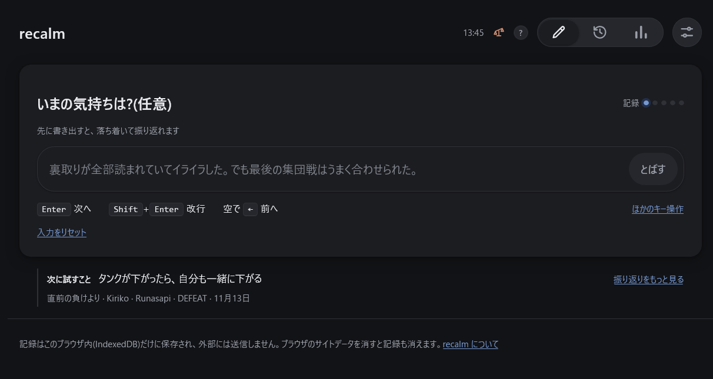

# recalm

Overwatch の試合後に、できたこと・できなかったことを行動のレベルで手入力し、感情的にならずゲームを楽しめる状態を目指す記録アプリです。

**公開URL:** https://recalm-log.vercel.app/



## 特徴

- 記録は**手入力のみ**です。ゲームのデータや画面には一切触れません。
- 記録はこのブラウザの **IndexedDB** にだけ保存されます。外部サーバーには送信しません。
- Blizzard のマップ・ヒーロー画像はリポジトリに含みません。

## 機能

| 画面 | 内容 |
| --- | --- |
| 記録 | 入力欄1つの問いかけ入力（気持ち → 結果 → マッチの質 → マップ → ヒーロー → 振り返り）。英字・ひらがな・カタカナ対応、`map` / `hero` / `/` / `Ctrl+Space` で一覧表示 |
| 履歴 | 「まとめ」（ロール別勝敗・振り返り一覧）と「試合一覧」（1日ごとの確認・追記・編集・削除） |
| 集計 | 次に試すこと・気持ちの記入率、セッション経過時間別の勝率 |
| 設定 | 表示の切り替え、自動保存（Chrome・Edge はフォルダ上書き / Firefox 等はダウンロード）、JSON バックアップ |

## ローカルで動かす

ビルドは不要です。`index.html` を直接開くと `data/master.json` を読み込めないため、ローカルサーバーを起動して開きます。

```bash
python -m http.server 8000
```

`http://localhost:8000/` を開きます。

## バックアップ

ブラウザのサイトデータを消すと記録も消えます。設定画面の「自動保存」または「バックアップ（JSON 書き出し）」を利用してください。

- 書き出したファイル（`recalm-backup-*.json`）は個人の記録です。リポジトリにはコミットしません（`.gitignore` 済み）。
- 読み込むと現在の記録を置き換えます（実行前に確認が出ます）。
- データはオリジン（URL ごと）に保存されます。別 URL へ移る場合はバックアップで移行してください。

## マップ・ヒーローの更新

`data/master.json` を編集します。アプリ内の編集画面はありません。

## テスト

```bash
npm test
```

## 権利表記

本アプリケーションは個人が開発した非公式・非商用のファンアプリであり、Blizzard Entertainment 社とは一切関係ありません。
Overwatch をはじめとするゲームタイトル、および関連するすべての商標・知的財産は、Blizzard Entertainment, Inc. に帰属します。

This is an unofficial, non-commercial fan project and is not affiliated with or endorsed by Blizzard Entertainment, Inc.
Overwatch and all related properties are trademarks or registered trademarks of Blizzard Entertainment, Inc.
